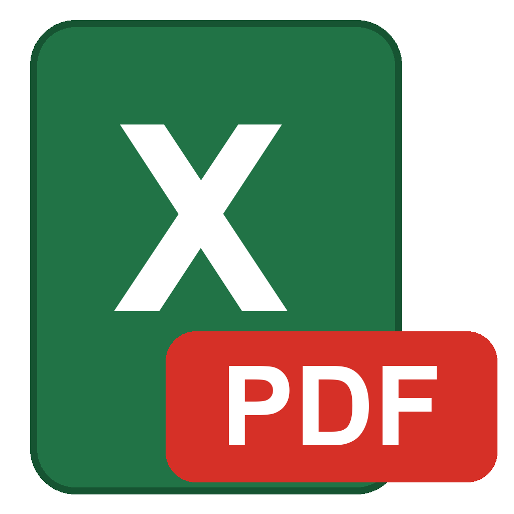

# Excel → PDF

Пакетная конвертация таблиц Excel в PDF для Windows — удобно для приложений к проектной документации.

## Возможности
- Перетаскивание файлов и папок (.xls, .xlsx, .xlsm), естественная сортировка по номерам в именах (PT2 перед PT10)
- Один PDF на файл или отдельный PDF на каждый лист
- Качество (печать / сжатое), бумага A4/A3, ориентация, «вписать по ширине», игнорирование областей печати
- Склейка всех файлов в один PDF
- Штамп «Приложение А, Б, В…» (буквы по ГОСТ 2.105) — на первой или на всех страницах
- Сквозная нумерация сверху и снизу («Стр. 3 из 10», «Лист 3»…), с возможностью сбрасывать в каждом приложении
- Выбор папки сохранения (запоминается)

## Требования
- Windows 10/11
- Установленный Microsoft Excel (конвертация идёт через него, поэтому результат совпадает с печатью из Excel)

## Сборка
Нужен только .NET Framework 4 (есть в любой Windows). Запустите `build.bat` — он скачает PdfSharp
и соберёт `Excel to PDF.exe` (PdfSharp вшивается внутрь, отдельные файлы не нужны).

## Лицензия
MIT. Используется [PdfSharp](https://github.com/empira/PDFsharp) 1.50 (MIT).
